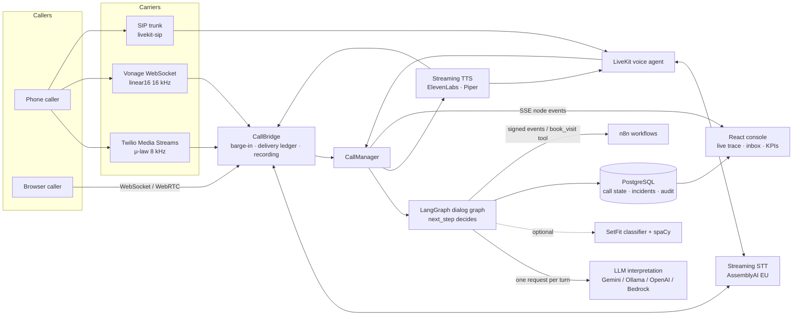

# FinCall

**A real-time AI phone agent that takes building-maintenance calls for property managers.**

A resident calls because the lift is stuck, there is a leak or the entry phone is broken. FinCall
answers in their language, finds the building and the apartment, works out what is wrong and how
urgent it is, opens the incident and tells the maintainer (or leaves it for the property manager
with a suggestion). It speaks over a real phone line (Twilio, Vonage, SIP) or from the browser,
streams speech both ways, and lets an operator watch every call live, node by node, in a web
console. A LangGraph dialog graph drives the call: **the LLM only interprets what the caller
said, and plain code decides what happens next.**


## Architecture



## Key features

- **Telephony**: one `CarrierChannel` interface for Twilio Media Streams and Vonage WebSockets
  (signed webhooks, marks, `clear` barge-in, DTMF), SIP through self-hosted LiveKit, and a
  browser "phone line" that speaks the Twilio protocol so the phone path can be tested without a
  number.
- **Streaming speech**: AssemblyAI Universal-Streaming (EU endpoint, enforced in code) with tuned
  end-of-turn silences; ElevenLabs `eleven_v4_turbo` streaming TTS (Piper/MeloTTS locally), with a
  per-language fallback chain.
- **"LLM interprets, code decides"**: one LLM request per turn at most, returning a flat JSON
  interpretation that is validated in code. Deterministic paths (yes/no, short addresses, "3º B",
  plain names, set phrases) skip the model entirely. A single `next_step` function owns the order
  of questions; nodes never chain each other.
- **Delivery ledger**: the agent knows which sentences the caller actually heard. If the caller
  barges in before an important notice, it is said again before the call ends.
- **Six languages**: Spanish, US English, Catalan, Arabic, Hindi and Urdu on one shared graph. A
  language is one TOML file (templates, word lists, voices); detection in the first turns and
  switching mid-call; right-to-left console for Arabic and Urdu.
- **Routing view**: the compiled graph drawn live (React Flow + ELK). Every node visit carries its
  timing, the condition that fired, the interpretation, LLM calls and a PII-free state diff, over
  SSE. Any stored call can be replayed step by step, and `/demo` replays a recorded call with no
  backend at all.
- **Integrations**: signed n8n events (HMAC, retries, `Idempotency-Key`) and a `book_visit` tool
  the agent calls during the call (1.5 s timeout, safe fallback); example n8n workflows for
  e-mail/Slack, SMS escalation and Google Calendar.
- **Hybrid NLP (optional)**: a multilingual SetFit turn classifier and spaCy entity rules answer
  confident turns in about 10 ms and send the rest to the LLM.
- **KPIs**: containment, handoff, abandon, reprompt and emergency rates, turns and LLM requests
  per call, handle time, and `response_ms` p50/p95.
- **Operations console**: simulate a call, call history with recordings, an inbox of incidents
  waiting for the property manager, editable buildings and maintainers, graph view, metrics,
  access requests. Sign-in with Google or Microsoft (OIDC + PKCE), no passwords; audit trail of
  changes and accesses.

## Measured results

All numbers come from the evaluation scripts in `backend/evals/` and are re-run whenever prompts
or models change.

**Turn interpretation** (gold sets in `backend/evals/gold_*.jsonl`, never trained on):

| Model / setting | Accuracy (all fields) | p50 | p95 |
|---|---|---|---|
| Gemini `gemini-3.5-flash-lite`, Vertex EU (production choice) | 98 % | 626 ms | 722 ms |
| `qwen3.5:4b`, local Ollama, full keys, one line, no nulls | 96 % | 611 ms | |
| same model, short keys | 82 % | 554 ms | |
| same model, pretty JSON with nulls | 98 % | 1170 ms | |
| Spanish prompt v8, local model | 95.1 % | 821 ms | 1388 ms |
| English prompt v3, local model | 97.0 % | | |

**Hybrid NLP vs LLM only** (local `qwen3.5:latest` as the LLM):

| Language | System | Intent acc / macro-F1 | Category acc | Urgency acc | Turns sent to the LLM |
|---|---|---|---|---|---|
| es | LLM only | 77.8 % / 0.690 | 97.8 % | 100 % | 100 % |
| es | Classifier only | 81.5 % / 0.748 | 84.8 % | 67.4 % | 0 % |
| es | **Hybrid @ 0.8** | **80.2 % / 0.806** | 97.8 % | 100 % | 91 % |
| en | LLM only | 90.8 % / 0.872 | 97.8 % | 97.8 % | 100 % |
| en | Classifier only | 82.4 % / 0.660 | 87.0 % | 69.6 % | 0 % |
| en | **Hybrid @ 0.8** | **91.6 % / 0.901** | 97.8 % | 97.8 % | 94 % |

**Latency** (`response_ms` = end of the caller's voice to start of the bot's voice; target ≤ 1200 ms):

| Path (voice bench, synthetic callers, 2026-10-22) | Scenarios passed | p50 | p95 | Turns |
|---|---|---|---|---|
| WebSocket voice path | 5/7 | 1134 ms | 1869 ms | 43 |
| LiveKit agent | 5/8 | 1592 ms | 3469 ms | 48 |

Deterministic turns add ~0 ms of model time; ElevenLabs' first audio is ~158 ms. The LiveKit
path is still behind the WebSocket path, and the bench says so.

**Tests**: about 980 backend tests (pytest, Spanish and English suites) plus frontend unit tests.

## Quick start

Requirements: Python 3.12 with [uv](https://docs.astral.sh/uv/), a current Node.js LTS with pnpm
(via `corepack`; npm is blocked on purpose), and optionally Docker for PostgreSQL.

**1. The routing demo, no backend needed**

```bash
cd frontend
corepack pnpm install
corepack pnpm run dev
# open http://localhost:5173/demo   (?theme=dark, ?lang=en|ca|ar|hi|ur)
```

**2. The API in memory mode (no database, no cloud keys)**

```bash
cd backend
uv sync
BC_REPOSITORY=memory BC_LLM=ollama BC_TTS=none uv run building-call   # API on :8000
uv run --extra voice pytest -q                                          # the test suite
```

`BC_LLM=ollama` expects a local Ollama with `qwen3.5:4b`. Cloud providers (Vertex, OpenAI,
Bedrock), AssemblyAI, ElevenLabs, Twilio and the console's Google/Microsoft sign-in are configured
through environment variables; `backend/.env.example` lists them all.

**3. Full stack with PostgreSQL**

```bash
docker compose up -d db
cd backend && uv run alembic upgrade head && uv run python -m building_call.repos.seed
BC_REPOSITORY=postgres uv run building-call
```

**4. A real browser call through Twilio** (Windows): `scripts/start-demo.ps1` starts the API in
memory mode, the console and a tunnel, and prints the URL to open. See
[docs/technical-overview.md](docs/technical-overview.md#run-the-demo).

## Tech stack

| Area | Choice |
|---|---|
| Backend | Python 3.12, FastAPI, LangGraph, SQLAlchemy + Alembic, PostgreSQL, uv |
| Speech | AssemblyAI streaming STT (EU), ElevenLabs streaming TTS, Piper/MeloTTS locally |
| LLMs | Gemini on Vertex AI (EU), Ollama locally, OpenAI and AWS Bedrock behind the same interface |
| Voice transport | Twilio Media Streams, Vonage, LiveKit (self-hosted) + livekit-sip, WebSocket |
| NLP | SetFit (sentence-transformers), spaCy |
| Frontend | React, TypeScript, Vite, Ant Design, React Flow + ELK |
| Automation | n8n (signed webhooks and a tool node) |
| Quality | pytest, Ruff, mypy (strict), Bandit, gitleaks |

## Repository layout

```text
backend/        FastAPI app, LangGraph graph, telephony, voice agent, NLP, evals and tests
frontend/       React operations console and the routing view
integrations/   n8n workflows (generated by build_workflows.py)
docs/           technical overview, telephony guide, design specs and plans, screenshots
scripts/        start-demo.ps1
```

More detail: [docs/technical-overview.md](docs/technical-overview.md) (languages, carriers, n8n,
NLP, KPIs), [docs/TELEFONIA.md](docs/TELEFONIA.md) (telephony) and the design specs in
`docs/superpowers/specs/`.

## Nota en español

FinCall nació para comunidades de propietarios en España: el producto (las frases del asistente,
la consola y buena parte de las especificaciones de diseño) está en español, y el código y esta
documentación en inglés. El asistente habla además inglés, catalán, árabe, hindi y urdu.

## License

[MIT](LICENSE) © 2026 Andreu Bofí Pla
