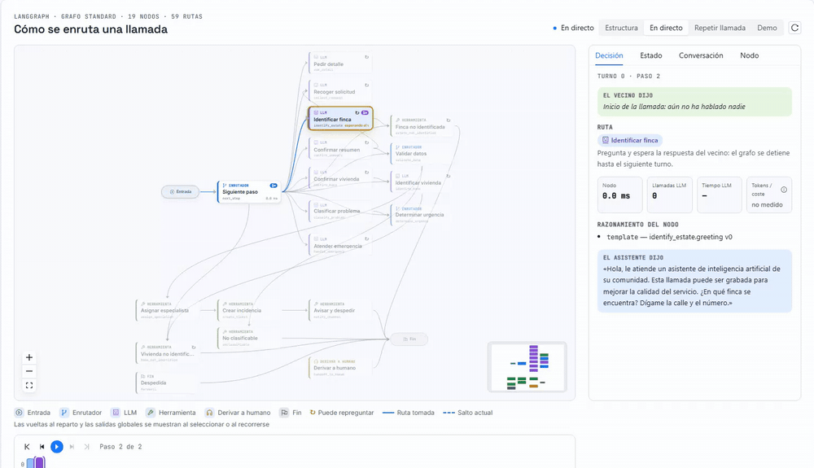
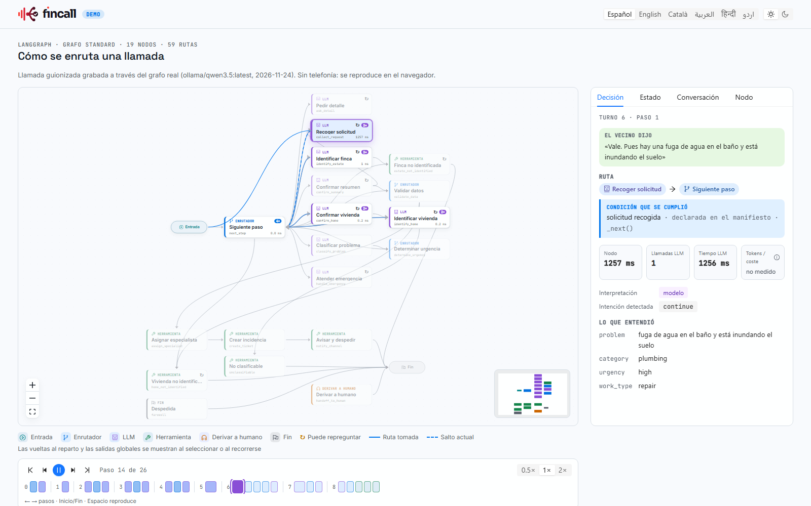
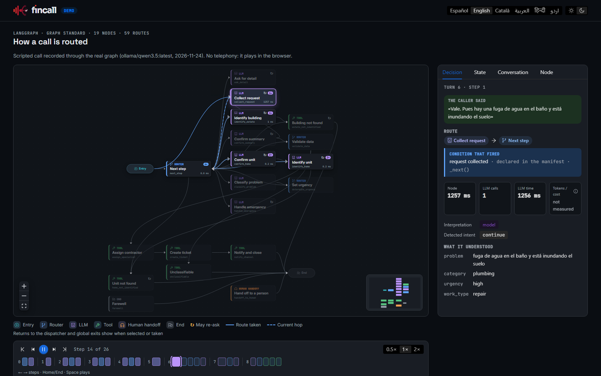
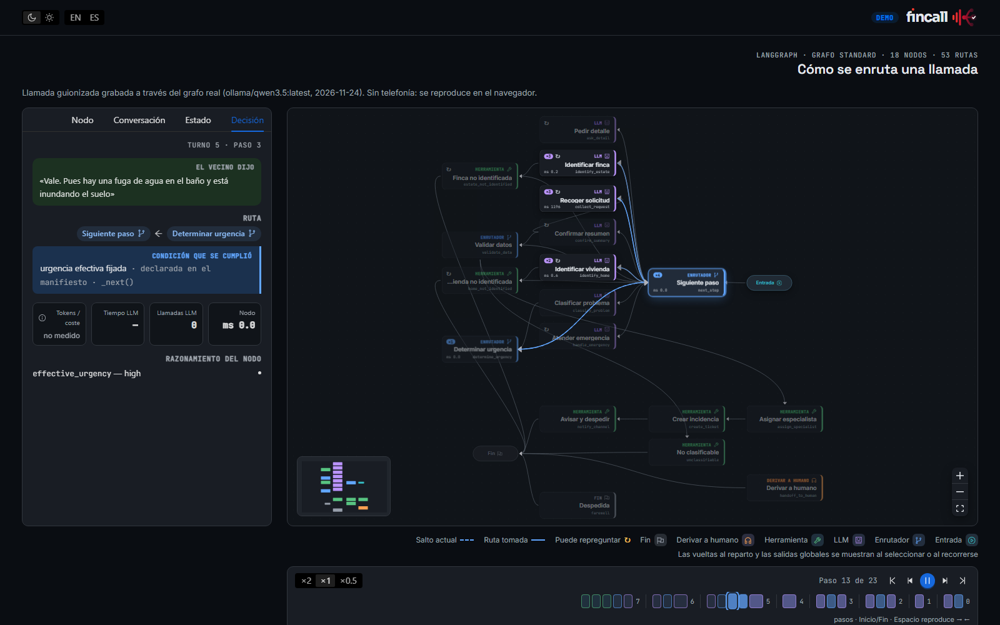
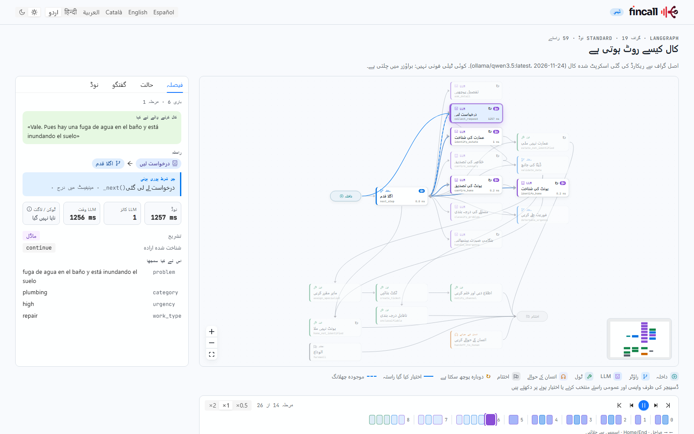

# Building Call Assistant

MCP local para que Codex y Claude consulten y editen la bóveda de Obsidian del proyecto.

## Puesta en marcha

```powershell
python -m pip install -e .\mcp_server
gh auth status
.\scripts\start-mcp-codex.ps1
```

Configura `config/codex-mcp.toml` en Codex y `config/claude-mcp.json` en Claude. Ambos usan el mismo proceso MCP y la misma bóveda. El transporte es `stdio`: el cliente lo levanta bajo demanda y lo termina al cerrar la sesión.

## RAG local y GraphRAG

El MCP incluye `rebuild_rag_index`, `rag_search` y `rag_context`. El índice SQLite FTS5 se guarda en `%LOCALAPPDATA%\BuildingCallAssistant\rag.sqlite3`, fuera de la bóveda y de Git. Se actualiza incrementalmente antes de buscar y puede reconstruirse con:

```powershell
.\scripts\rebuild-rag-index.ps1
```

Para recuperación semántica y relacional, el MCP también ofrece `rebuild_graph_index`, `hybrid_search`, `graph_context`, `graph_inspect` y `evaluate_rag`. Usa únicamente Ollama local: `mxbai-embed-large:latest` para embeddings y `qwen3.5:4b` para extraer relaciones con evidencia literal. El modo `quality` usa `qwen3:8b`.

```powershell
.\scripts\rebuild-graphrag-index.ps1
```

El índice híbrido fusiona FTS5 y vectores, deduplica por documento y conserva cada relación con su fragmento de evidencia. Las comunidades son componentes conectados deterministas; no se generan resúmenes inventados. Evalúa el retrieval contra el conjunto versionado en `mcp_server/evals/graphrag_gold.jsonl` mediante `evaluate_rag`.

## Git de la bóveda

La rama de trabajo de ambos clientes es `bofi`. El sincronizador sube los cambios y promociona automáticamente:

```text
bofi -> develop -> main
```

Ejecuta `scripts/sync-vault.ps1 -DryRun` para validar sin mutar GitHub. Los conflictos detienen la operación; no se usa `force-push` ni `reset --hard`.

## Autenticación

Usa `gh auth login` con un token fine-grained limitado al repositorio `<private-vault-repo>`, con `Contents: Read and write`, `Pull requests: Read and write` y `Metadata: Read-only`. La clave se guarda en el keyring de GitHub CLI, no en este repositorio.

## Cómo enruta LangGraph una llamada (vista de enrutado)



La pantalla **Flujo** (y la columna derecha de **Simular llamada**) dibuja el grafo de LangGraph tal
como está compilado y enseña, nodo a nodo, por qué la llamada fue a cada sitio.

- **Estructura**: `GET /api/graph/structure` exporta los nodos de `compiled.get_graph()` y las rutas
  del manifiesto con su condición, verificadas contra las aristas condicionales compiladas
  (`drift` vacío o la vista lo avisa). Disposición automática con ELK; ninguna coordenada a mano.
- **En directo**: `GET /api/calls/{id}/events` (SSE) emite `node_enter`, `node_exit` y `turn_end`.
  Cada visita (`backend/src/building_call/graph/tracing.py`) lleva el tiempo del nodo, el salto,
  la condición declarada que se cumplió, la intención y si se interpretó con o sin modelo, las
  llamadas y el tiempo del LLM, validaciones y un diff de estado sin datos personales. Tokens y
  coste se muestran como «no medido»: el proveedor no los devuelve en este flujo.
- **Repetir llamada**: cualquier llamada guardada, paso a paso (← → Inicio Fin Espacio), con el
  turno de la conversación de cada visita y el diff de estado o el estado acumulado.
- **Demo**: `http://localhost:5173/demo` reproduce una llamada grabada a través del grafo real,
  sin sesión, backend ni telefonía (`?theme=dark`, `?lang=en|ca|ar|hi|ur`). Se vuelve a grabar con
  `cd backend; uv run python evals/record_demo_call.py --model qwen3.5:latest`; un test falla si
  el grafo cambia y la grabación no.

| Claro | Oscuro |
| --- | --- |
|  |  |
|  |  |
|  |  |

La vista está en los seis idiomas de la consola (es, en, ca, ar, hi, ur; RTL en árabe y urdu): textos
con claves `routing.*`/`flow.*` en `frontend/src/i18n/messages/`, y títulos de nodo y condiciones de
ruta traducidos por id (`routing.graph.*`). El resumen de cada nodo se queda en el idioma del código.

Tests: `cd backend; uv run --extra voice pytest tests/test_routing_view.py` y `cd frontend; corepack pnpm run test`.

## Arrancar la aplicación en local

```powershell
docker compose up -d db                       # PostgreSQL 17 (127.0.0.1:5433, datos en volumen)
cd backend
uv run alembic upgrade head                   # esquema
uv run python -m building_call.repos.seed  # fincas y administradores de demostración
uv run building-call                          # API en :8000 (lee backend/.env)
cd ../frontend; corepack pnpm run dev         # consola en :5173
```

Pila completa en contenedores: `docker compose up -d` (web en `http://localhost:8080`, Ollama sigue en el host).
Con `backend/.env` en `BC_REPOSITORY=postgres` y `BC_DATABASE_URL=postgresql+asyncpg://building_call:<contraseña>@127.0.0.1:5433/building_call`.

### Acceso a la consola operativa

La consola es privada: usuarios internos con contraseña, sin proveedor externo de identidad.

1. Al arrancar la API por primera vez (sin usuarios en la base de datos) se crea el owner inicial
   `admin` / `admin` (o lo que indiquen `BC_ADMIN_INICIAL_USUARIO` / `BC_ADMIN_INICIAL_CONTRASENA` en `backend/.env`).
2. Entra en la consola con ese usuario: **te obligará a elegir una contraseña nueva** (mínimo 10 caracteres)
   antes de poder ver nada. Hasta entonces la API responde `403` en todo lo que no sea `/api/auth/*`.
3. En la pestaña **Usuarios** (solo rol `owner`) das de alta a más personas: cada alta o restablecimiento
   genera una contraseña temporal que se muestra una única vez y que el usuario debe cambiar al entrar.
   Desde ahí también cambias roles (`owner`, `administrator`, `quality`), desactivas o eliminas usuarios.

### Usar la consola fuera de casa (túnel ngrok)

La consola no se despliega en ningún sitio todavía: para usarla desde fuera se publica el servidor
de desarrollo por un túnel https. Se expone **el 5173**, no la API: Vite ya hace de proxy de `/api`
y del WebSocket de voz, así que todo viaja por un único origen y no hacen falta ni CORS ni cambios
en la cookie. El micrófono, además, solo funciona en contexto seguro, y el túnel da https.

```powershell
cd frontend; $env:BC_TUNEL=1; corepack pnpm run dev    # atiende en 127.0.0.1:5173
ngrok http 127.0.0.1:5173                              # en otra terminal
```

`BC_TUNEL=1` hace dos cosas: atender también en IPv4 (por defecto Vite solo escucha en `::1` y el
túnel no llegaría) y apuntar el cliente de HMR al 443 público. El Host del túnel ya está en
`allowedHosts`; sin eso Vite responde *Blocked request*.

La URL que imprime ngrok es **pública**: la protege solo el usuario y la contraseña de la consola,
y al otro lado hay grabaciones y datos de vecinos. Úsala mientras la necesites y corta el túnel
después; con el plan gratuito la URL cambia en cada arranque. La primera visita muestra el aviso
de ngrok: hay que pulsar *Visit Site* una vez para que las peticiones de la aplicación pasen.

### Telefonía

El asistente puede atender un número real (Twilio Media Streams; proveedor Provisional). Con las
credenciales y una URL https pública, `uv run python -m building_call.telephony.configure` deja el
número apuntando a la API. Guía completa en `docs/TELEFONIA.md`.

### Multilingual architecture

The agent speaks **Spanish (es-ES), US English (en-US), Catalan (ca-ES), Arabic (ar-AE), Hindi
(hi-IN) and Urdu (ur-PK)** on one shared LangGraph graph. A language is configuration, not code.

```text
 caller audio ─▶ STT (AssemblyAI EU, language_codes) ──text──▶ CallManager
                    ▲  UpdateConfiguration on switch               │ i18n.use(call language)
                    │                                              │ personas.use(client persona)
                    │                                              ▼
            detection ◀── first turns: script + function words ── graph (shared nodes)
            (+ AssemblyAI's language_code / confidence)            │  parser_for(lang): yes/no,
                                                                   │  apartments, set phrases
                                                                   │  render(id): template in lang
                                                                   │  LLM prompt set: es | en+note
                                                                   ▼
 caller ear ◀── TTS chain per language (ElevenLabs → Piper → MeloTTS) ◀── reply text
```

- **One file per language**: `backend/src/building_call/i18n/locales/<code>.toml` holds the
  locale, RTL flag, STT/TTS settings and voices, the word lists of the deterministic paths
  (yes/no, refusals, set phrases, spelled-out numbers, floors and apartment words, gas/fire),
  the translations of every template, FAQ answers, detail questions and admin-facing phrases.
  Adding a 7th language means adding one file: the tests check it translates every template
  with the same variables and question marks.
- **Rules no word list can express** live in `i18n/parsing.py` (`Parser`, generic and lexicon
  driven; `SpanishParser` keeps the rules tuned on real Spanish calls). Formats (dates, numbers,
  currency, ordinals, lists) come from CLDR via Babel (`i18n/formatting.py`).
- **Choosing the language of a call**: explicit (`POST /api/calls {"language"}`, the console,
  a `language` Media Streams parameter, `BC_TWILIO_NUMBER_LANGUAGES` per called number), else
  `BC_LANGUAGE` plus **detection** of the caller's first turns (`i18n/detection.py`: script,
  Arabic vs Urdu letters and words, distinctive function words for Latin script, AssemblyAI's
  reported language when it is sure). It switches only above `BC_LANGUAGE_DETECTION_THRESHOLD`
  (default 0.6), otherwise the call stays in the default language. Asking by name ("English,
  please") switches at any time and the current question is asked again in that language.
- **Mid-call switch**: STT is steered with AssemblyAI `UpdateConfiguration` (no reconnect), TTS
  changes `language_code`/voice per sentence; the phone bridge, the console WebSocket and the
  LiveKit agent all follow it.
- **Prompts**: Spanish keeps its measured prompt set; every other language uses the English
  prompts (what models follow best) plus a note asking for values in the caller's language.
- **Client personas** (`i18n/personas/<id>.toml`): agent name, ElevenLabs voice, tone for the
  phrasing model, greeting and FAQ answers per language; chosen per number
  (`BC_TWILIO_NUMBER_PERSONAS`), per call or by `BC_PERSONA`.
- **Console**: six UI languages, right-to-left for Arabic and Urdu (`frontend/src/i18n`).

#### Providers per language

Checked against the providers' current documentation (November 2026).

| Language | STT (streaming) | Server TTS | Local TTS (dev) | Twilio `<Say>` fallback | LLM |
|---|---|---|---|---|---|
| es-ES | AssemblyAI Universal-Streaming (EU) | ElevenLabs `eleven_v4_turbo` | Piper `es_ES-davefx-medium`, MeloTTS | `Polly.Lucia-Neural` | Gemini (Vertex EU) / Ollama |
| en-US | AssemblyAI (EU) | ElevenLabs | Piper `en_US-lessac-medium`, MeloTTS | `Polly.Joanna-Neural` | Gemini / Ollama |
| ca-ES | AssemblyAI (EU) | ElevenLabs (v3/v4 only: Flash v2.5 has no Catalan) | Piper `ca_ES-upc_ona-medium` | `Polly.Arlet-Neural` | Gemini |
| ar-AE | AssemblyAI (EU) | ElevenLabs | Piper `ar_JO-kareem-medium` | `Polly.Hala-Neural` | Gemini |
| hi-IN | AssemblyAI (EU) | ElevenLabs | Piper `hi_IN-pratham-medium` | `Polly.Kajal-Neural` | Gemini |
| ur-PK | AssemblyAI (EU) | ElevenLabs (v3/v4 only) | **none** (no Piper voice) | **none**: falls back to `BC_LANGUAGE`'s voice | Gemini |

Fallbacks: the server TTS is a per-language chain (`FallbackSynthesizer`): the configured
provider first, then the next available one that speaks the language; Urdu has no local voice,
so without ElevenLabs it has no server voice (the console then uses the browser's voice, if the
OS has an Urdu one). If AssemblyAI is unavailable, the console falls back to the browser's
speech recognition (`browser_lang`); phone calls need AssemblyAI. Local Ollama models are weak
in Urdu and Hindi: use Gemini for those languages in production.

### Run the demo

One script starts everything for a browser call through Twilio: the API with in-memory data
(no PostgreSQL), the console behind ngrok, and Twilio browser calls.

1. Once: `backend/.secretbroker` maps `BC_TWILIO_ACCOUNT_SID`, `BC_TWILIO_AUTH_TOKEN`,
   `BC_TWILIO_API_KEY_SID` and `BC_TWILIO_API_KEY_SECRET` (names only, no values), and
   `BC_TWILIO_TWIML_APP_SID`, `BC_OWNER_EMAIL` and the voice settings are in `backend/.env`.
2. Give it your fixed ngrok domain, then run it:

   ```powershell
   $env:BC_PUBLIC_URL = "https://<your-domain>.ngrok-free.dev"   # or -PublicUrl, or a SecretBroker config entry
   .\scripts\start-demo.ps1
   ```

   It prints the URL to open once `/api/health` answers through the tunnel. Ctrl+C stops the
   API, the console and ngrok. Logs are in `%TEMP%\fincall-demo`.
3. Open the URL, click *Visit Site* on the ngrok notice, and sign in with Google or Microsoft.
4. In **Simulate a call**, pick the voice mode **Twilio**, choose the call language (or
   *Detect automatically*), and press **Start call**.

Data lives in memory and is gone when the script stops. A browser call costs Twilio's Client
rate per minute.

### Talking to the agent from the browser, as a phone caller

Two ways to test the **phone path** (μ-law 8 kHz, server STT and TTS, barge-in, delivery
ledger, two-track recording) without a phone number. Both are voice modes of the console's
simulator, and the console follows the call live in either.

**1. Phone line (no Twilio): `Phone line` mode.** The browser captures the microphone at 8 kHz,
encodes G.711 μ-law in 20 ms frames and sends them over `WS /api/telephony/browser/line`, which
speaks the Twilio Media Streams protocol (`start`/`media`/`mark`/`clear`/`stop`) and plugs into
the same `CallBridge` as a phone call (`telephony/browser_line.py`, `frontend/src/phoneLine.ts`).
It needs only the console session, `BC_ASSEMBLYAI_API_KEY` and a server voice (`BC_TTS`): no
Twilio account, no public URL, no cost beyond STT/TTS.

**2. Twilio Voice JS SDK (WebRTC): `Twilio` mode.** The browser gets a 15-minute Access Token
(`POST /api/telephony/twilio/browser-token`, identity `console_<user>`) and dials a TwiML App
whose voice URL is the same webhook as the phone number; Twilio then opens the Media Stream to
the bridge. The real carrier path, still with no phone number. Setup, once:

1. Twilio credentials in SecretBroker (tag `fincall`): account SID and auth token
   (`BC_TWILIO_ACCOUNT_SID`, `BC_TWILIO_AUTH_TOKEN`), `BC_TELEPHONY=twilio`.
2. A **Standard API key** created in the Twilio console (Account → API keys); store its SID and
   secret as `BC_TWILIO_API_KEY_SID` / `BC_TWILIO_API_KEY_SECRET` (Access Tokens are signed with it).
3. A public https URL for the API (`BC_PUBLIC_URL`, e.g. the fixed ngrok domain) so Twilio can
   reach the webhook and the Media Stream.
4. `uv run python -m building_call.telephony.configure --twiml-app` creates or updates the
   "FinCall console" TwiML App (voice URL = the webhook) and prints `BC_TWILIO_TWIML_APP_SID`.
   It creates nothing else and buys nothing; browser (Client) minutes are billed by Twilio at its
   Client rate when a call is made.
5. Restart the API: `GET /api/health` shows `twilio_browser: true` and the console enables the
   mode. On a trial account Twilio plays a short notice first; the console presses the key.

Seguridad: contraseñas solo como hash scrypt; token de sesión opaco en cookie `HttpOnly` (`Secure` fuera de
localhost) con solo su hash en BD; sesiones revocables (logout, cambio de contraseña, desactivación, baja);
bloqueo temporal tras 5 intentos fallidos por usuario o IP (`BC_LOGIN_MAX_INTENTOS`, `BC_LOGIN_BLOQUEO_S`);
todo acceso y toda gestión de usuarios quedan en la auditoría. `BC_SESSION_SECRET` firma las URLs con las que
se descargan las grabaciones: es **obligatorio** (mínimo 32 caracteres) con `BC_REPOSITORY=postgres` y la API
se niega a arrancar sin él; genéralo con `python -c "import secrets; print(secrets.token_urlsafe(48))"`.

## NLP models and evaluation

The call graph interprets each caller turn with one LLM request. `backend/src/building_call/nlp/`
adds classic NLP in front of it, **off by default** (`BC_NLP_HYBRID=false`):

- **Turn classifier (Hugging Face, SetFit).** A multilingual sentence-transformer
  (`paraphrase-multilingual-MiniLM-L12-v2`), fine-tuned contrastively, with one
  logistic-regression head each for intent, incident category, urgency and work type. One encode
  answers all four in about 11 ms on CPU. Training data, the reproducible script and the reasons
  for this model are in [`backend/nlp/MODEL_CARD.md`](backend/nlp/MODEL_CARD.md). The weights
  are not in git; `nlp/train_classifier.py` rebuilds them in about a minute on an RTX 4070
  SUPER.
- **spaCy entities.** One blank pipeline per language with an `EntityRuler`: address, entrance,
  floor, door, building, name, phone and email in es, en, ca, ar, hi and ur. The home words come
  from each language's locale file.
- **Hybrid routing.** The classifier answers first. The graph skips the LLM only when every
  needed label is at or above `BC_NLP_THRESHOLD` (0.8) and no entity is found in the turn. That
  covers two cases: a global intent with no data ("¿esto se graba?", "quiero hablar con una
  persona") and a plain problem description. Corrections always go to the LLM. Handing over or
  hanging up still needs the caller's explicit words.

Results on the gold sets, which are never trained on (`evals/gold_*.jsonl`; es: 81 intent rows
and 46 classification rows; en: the same in English). The LLM here is the local
`qwen3.5:latest` (9.7B, Ollama).

| Language | System | Intent acc | Intent macro-F1 | Category acc | Category macro-F1 | Urgency acc | Urgency macro-F1 | p50 ms | p95 ms | Turns to the LLM | USD / 1,000 calls* |
|---|---|---|---|---|---|---|---|---|---|---|---|
| es | LLM only | 77.8 % | 0.690 | 97.8 % | 0.985 | 100 % | 1.000 | 5 289 | 6 615 | 100 % | 0.66 |
| es | Classifier only | 80.2 % | 0.743 | 91.3 % | 0.948 | 69.6 % | 0.652 | 13 | 26 | 0 % | 0.00 |
| es | **Hybrid @ 0.8** | **81.5 %** | **0.836** | 97.8 % | 0.985 | 100 % | 1.000 | 5 196 | 6 630 | 90 % | 0.59 |
| en | LLM only | 84.9 % | 0.789 | 97.8 % | 0.988 | 97.8 % | 0.984 | 5 108 | 6 679 | 100 % | 0.66 |
| en | Classifier only | 75.3 % | 0.702 | 84.8 % | 0.869 | 73.9 % | 0.740 | 11 | 15 | 0 % | 0.00 |
| en | **Hybrid @ 0.8** | **86.0 %** | **0.815** | 97.8 % | 0.988 | 97.8 % | 0.984 | 4 932 | 6 693 | 92 % | 0.61 |

\* LLM requests priced as the production model (`gemini-3.5-flash-lite`: $0.30 / $2.50 per
1M input/output tokens, Gemini API price list, 2026-11-24). Tokens are estimated (characters /
4), and a call is assumed to make 4 LLM-eligible turns. Local models cost $0.

```powershell
cd backend
uv sync --extra nlp
uv run python nlp/data/build_dataset.py --seed 13
uv run python nlp/train_classifier.py
uv run python evals/compare_nlp.py --llm qwen3.5:latest --language es --thresholds 0.6,0.7,0.8,0.9,0.95
uv run python evals/compare_nlp.py --llm qwen3.5:latest --language en --thresholds 0.6,0.7,0.8,0.9,0.95
uv run python evals/compare_nlp.py --entities-only --language es   # spaCy vs regex
```

What the numbers say:

- **Hybrid beats LLM-only on intent in both languages and never loses on category or urgency.**
  The classifier catches questions to the assistant that the LLM misses ("question"
  F1 is 0.00 for the LLM alone in Spanish, 1.00 hybrid). It answers about 1 turn in 10 without
  the LLM, which cuts the estimated cost by 8 to 10 %.
- **The classifier alone is not enough.** Urgency is a judgement call and the classifier gets
  70 to 74 % of it. Since the router needs category, urgency and work type all at or above the
  threshold, problem descriptions stay on the LLM. At 0.6 the router starts answering them, and
  English category accuracy drops to 93.5 %. 0.8 is the lowest threshold with no loss in either
  language.
- **Latency:** the classifier adds about 11 ms per turn. The LLM latencies above come from a
  9.7B model that did not fit fully in GPU memory on the test machine (other apps were holding
  VRAM). They show the relative cost, not production latency. The production LLM (Vertex
  `gemini-3.5-flash-lite`) was measured at p50 626 / p95 722 ms (`settings.py`). The saving
  is the classifier-answered turns, which take about 11 ms instead of an LLM round trip.
- **Entities (gold recall).** In Spanish, the combined extractor lifts door from 38 % (regex) to
  88 % and floor from 92 % to 100 %. It adds address (83 %) and name (100 %), which the regex
  never had. In English, address and name reach 100 %, and floor and door stay as good as the
  regex. Arabic, Hindi, Urdu and Catalan have unit tests but no gold set yet.

Cloud LLMs: `BC_LLM=openai` (Responses API with strict Structured Outputs, default
`gpt-6-luna`) and `BC_LLM=bedrock` (Converse API with structured output, Bedrock API key,
`eu-*` regions only, default `eu.anthropic.claude-haiku-5-5`) sit behind the same interface. Compare
them with `sb run -- uv run python evals/compare_models.py --models openai:gpt-6-luna,bedrock:eu.anthropic.claude-haiku-5-5`
once their keys are in SecretBroker (`BC_OPENAI_API_KEY`, `BC_BEDROCK_API_KEY`).

## Call metrics

`GET /api/operations/kpis?limit=200` (aggregate of the last N stored calls) and
`GET /api/operations/calls/{id}/kpis` (one call) compute conversation KPIs from what the
operational repository already stores: calls, turns and graph decisions. They have the
reviewer roles of the rest of the console and return no personal data. The **Rendimiento**
screen shows them in a panel (texts in the six console languages, RTL for Arabic and Urdu; see
`docs/screenshots/kpi-panel-*.png`).

| KPI | Definition (`backend/src/building_call/kpis.py`) |
|---|---|
| Containment rate | Finished calls the assistant resolved alone (result `incident_created`) |
| Human handoff rate | Finished calls where the caller asked for a person (`handed_to_administrator`) |
| Needs the administrator | Finished calls that were not contained, abandoned ones excluded |
| Abandon rate | Finished calls that ended `abandoned` |
| Reprompt / fallback rate | Caller turns where the conversation did not move on (same node after the turn, or a repeat/filler), over all caller turns |
| Emergency rate | Calls that reached `handle_emergency` without ruling the emergency out |
| Turns per call, LLM requests per call | Caller turns (the greeting does not count); `llm_calls` from the turn timings |
| Average handle time | `finished_at - started_at` of finished calls |
| Latency p50 / p95 | `response_ms` (end of caller voice to start of bot voice, from the metrics registry) and `server_ms` (stored per turn) |
