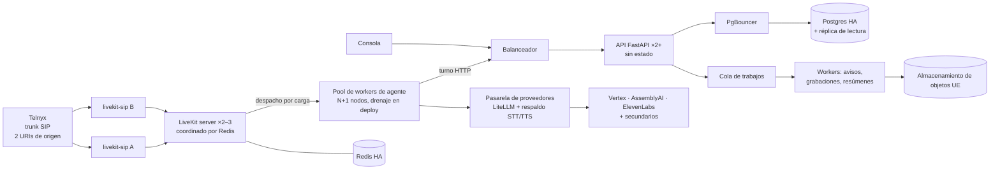

# Arquitectura escalable para muchas llamadas

Fecha: 2026-10-23 · Estado: **Pendiente** (nada de esto está aprobado) ·
Sustituye a las secciones «Capacidad estimada» e «Infraestructura propuesta» de
[2026-10-10-plan-de-escalado-design.md](2026-10-10-plan-de-escalado-design.md), que suponían Twilio,
Piper y Cloudflare. El resto de aquel plan (multi-administrador, paginación, avisos reales…) sigue vigente.

Todas las cifras de capacidad son **hipótesis** a partir del código y de la arquitectura actual
(LiveKit + agente + API + Postgres; STT, LLM y TTS por API). Ninguna está medida bajo carga. La
primera tarea de la etapa 1 es medirlas.

## 1. Cuánto tráfico hay que aguantar

Escenario de trabajo: 7–8 administradores, 300–400 fincas cada uno, 5–70 llamadas por finca y mes.

| | Bajo | Central | Alto |
|---|---|---|---|
| Fincas | 2.100 (7 × 300) | 2.800 | 3.200 (8 × 400) |
| Llamadas/finca/mes | 5 | 20 | 70 |
| Llamadas/mes | 10.500 | 56.000 | 224.000 |
| Llamadas/día laborable (22) | ≈ 480 | ≈ 2.550 | ≈ 10.200 |
| Hora punta (12 % del día) | ≈ 58 | ≈ 306 | ≈ 1.220 |
| Llamadas a la vez de media en punta (3 min/llamada) | ≈ 3 | ≈ 15 | ≈ 61 |
| **Canales a dimensionar** (Erlang B 1 % + ×1,5 por ráfagas) | **≈ 10** | **≈ 35** | **≈ 110–150** |

Las ráfagas importan más que la media. Una avería común (ascensor parado, sin agua, una inundación en el
garaje) hace llamar a 10–20 vecinos de la misma finca en pocos minutos. Por eso se multiplica por 1,5.

**Objetivo de diseño:** que la arquitectura aguante **150 llamadas simultáneas** con margen y llegue a
**500** añadiendo máquinas, sin rediseñarla.

## 2. Qué consume una llamada (hipótesis que hay que medir)

| Recurso | Por llamada | 150 llamadas | Comentario |
|---|---|---|---|
| CPU del agente (VAD silero, remuestreo, sockets) | 0,15–0,3 vCPU | 25–45 vCPU | El agente usa un proceso por llamada (`AgentServer`) |
| RAM del agente | 250–400 MB | 40–60 GB | Lo que más limita en una sola máquina |
| LiveKit + livekit-sip | ≈ 0,05 vCPU | ≈ 8 vCPU | Solo audio, sin vídeo |
| Ancho de banda (SIP G.711 ida+vuelta, STT de subida, TTS de bajada) | ≈ 0,8 Mbps en el pico | ≈ 120 Mbps | No es el límite |
| Paquetes UDP (RTP a 50 pps por sentido) | 100 pps | 15.000 pps | En una VPS virtualizada da jitter: los nodos de medios, mejor en dedicados |
| Escrituras en Postgres (estado vivo por turno, migración 0008) | 1 turno cada ≈ 8 s | < 200 escrituras/s | Trivial para Postgres. Lo que limita son las conexiones (PgBouncer) |
| Peticiones al LLM (≈ 40 % de los turnos) | — | ≈ 450 por minuto | Cuota de Vertex |
| Sesiones STT abiertas | 1 durante toda la llamada | 150 | Cuota de concurrencia de AssemblyAI |
| Peticiones TTS a la vez | 0,3–0,5 | 50–75 | Límite de concurrencia del plan de ElevenLabs |

Conclusiones:

1. **Las máquinas no son el cuello de botella; lo son las cuotas de los proveedores.** Antes que la CPU
   llegan los límites de ElevenLabs, AssemblyAI, Vertex y los canales de Telnyx. Todo eso se negocia por
   contrato y tarda semanas. Los valores exactos de cada plan están **por verificar**.
2. **El coste variable manda.** Con 0,08–0,20 € por llamada (estimación por verificar: telefonía + STT +
   TTS + LLM), el escenario central cuesta 4.500–11.000 €/mes en proveedores y el alto 18.000–45.000 €.
   Los servidores se quedan en 150–1.500 €/mes. Acortar las llamadas, usar caminos deterministas y
   cachear las frases fijas del TTS ahorra más que afinar servidores.
3. **Sobredimensionar los servidores sale barato.** Para empezar basta con un pool fijo con N+1 nodos.
   El autoescalado no compensa: el tráfico es diurno y predecible.

## 3. Principios del diseño

1. **La llamada es la unidad de trabajo y tiene un solo dueño.** Una llamada vive entera en un único
   proceso del agente. El balanceador de las llamadas es el propio despacho de LiveKit: los workers
   informan de su carga y el servidor manda cada llamada nueva a uno con hueco. Para el audio no hace
   falta un balanceador HTTP con afinidad.
2. **La API no guarda estado.** Desde la migración 0008 el estado vivo está en Postgres y el agente
   llama a la API en cada turno (`ApiClient`). Por eso la API se puede replicar detrás de un balanceador
   normal. Las sesiones de la consola ya están en Postgres.
3. **Control de admisión, nunca silencio.** Hay un tope global y otro por administrador de llamadas
   simultáneas. Al llenarse, el vecino oye un mensaje («todas las líneas ocupadas…») y se le ofrece una
   alternativa: deja el aviso grabado, se le pasa a la administración o se le devuelve la llamada. Que el
   teléfono suene sin respuesta no vale nunca.
4. **Equidad entre clientes.** La avería de una finca grande no puede dejar sin línea a los demás
   administradores. Por eso hay una cuota por administrador y una reserva mínima para cada uno.
5. **Las llamadas duplicadas se resuelven en el producto.** Si la misma finca ya tiene abierta la misma
   avería en los últimos minutos, el bot dice «ya nos consta» y la llamada se acorta. Así baja la carga,
   baja el coste y el administrador recibe menos ruido.
6. **Fuera del camino crítico,** todo lo que no sea responder al vecino: avisos, subir la grabación,
   resúmenes, auditoría pesada. Va a una cola (Postgres con `SKIP LOCKED` al principio) y lo procesan
   workers aparte.
7. **Desplegar sin cortar llamadas.** Los workers se drenan: dejan de aceptar llamadas nuevas y esperan a
   que acaben las vivas. Los nodos de medios se despliegan en azul/verde.
8. **Si cae un proveedor, el servicio se degrada en vez de caerse.** El LLM pasa por LiteLLM (ya está en
   el stack) con un modelo de respaldo. STT y TTS tienen proveedor secundario y cortacircuitos. Si no
   queda ninguno, se toma nota del aviso y se deriva al administrador.
9. **Las medidas antiabuso también son capacidad.** Hay que alinearlas con
   [2026-10-23-security-hardening-and-release-gates-design.md](2026-10-23-security-hardening-and-release-gates-design.md)
   (tareas B2–B4, C9, C11 y D4):
   - **En el piloto:** 5 llamadas a la vez en total; 3 por hora y 10 al día por número de origen (los
     números ocultos comparten una sola cuota); 8 min como máximo por llamada; un corte automático al
     pasar de 20 €/día de gasto.
   - **Con varios administradores:** el tope global se completa con una cuota por administrador
     (`administrator_id`, el mismo aislamiento que la tarea C11) y otra por finca. Los contadores van en
     Postgres mientras haya una sola réplica y en Redis desde la etapa 3.
   - **Segmentación de red, que se mantiene al repartir en varios nodos:** Postgres no es accesible
     desde la red de Caddy; solo se exponen Caddy y livekit-sip con su RTP, este último solo a las IP de
     Telnyx; la consola va detrás de un túnel.

## 4. Etapas

### Etapa 0 — Hoy

El portátil, más un túnel si hace falta. Llamadas simuladas y SIP probado en local (`feat/sip-local`).

### Etapa 1 — Piloto en una sola VPS

- **Máquina:** la VPS más barata de OVH (≈ 4 vCPU / 8 GB, Francia). Lleva todo: Caddy, API, Postgres,
  Redis, LiveKit, livekit-sip y el agente. Las tareas concretas están en el plan de telefonía
  (`plans/2026-10-23-telephony-ovh-vps-tasks.md`, en `feat/sip-local`).
- **Capacidad supuesta:** 10–15 llamadas a la vez, sin medir. Alcanza para un administrador piloto
  (≈ 3.000 llamadas/mes, 2–3 a la vez en la hora punta).
- **Hay que hacerlo ya, porque es lo que abarata las etapas siguientes:**
  1. **Prueba de carga:** N llamadas sintéticas en paralelo, ampliando `evals/e2e_livekit.py`. Mide el
     `response_ms` p95, la CPU y la RAM por llamada, y con eso se rellena la tabla de la sección 2.
  2. **Tope global configurable** de llamadas simultáneas, con un mensaje cuando no hay líneas.
  3. **Métricas de capacidad:** llamadas en curso, carga de los workers y errores 429/5xx de cada
     proveedor.
  4. **Copias de Postgres fuera de la máquina,** con una restauración probada.
  5. **Grabaciones** (si se graba) en almacenamiento de objetos de la UE desde el primer día, no en disco.
- **Coste fijo:** ≈ 10–20 €/mes.

### Etapa 2 — Crecer en vertical y separar los datos

**Cuándo:** un segundo administrador, más de 6 llamadas a la vez en p95 o más del 60 % de la capacidad
medida.

- **Base de datos gestionada** con recuperación a un instante concreto (PITR), en OVH Public Cloud
  Databases o similar en la UE. Hay que sacarla primero: es lo único que no se puede perder.
- **Dos máquinas:**
  - **Medios + agentes:** VPS grande o dedicado de entrada, 8–16 vCPU y 32 GB.
  - **API + consola + workers de la cola.**

  Así un despliegue de la API no toca las llamadas y el audio no compite con las consultas.
- **Capacidad:** 30–40 llamadas a la vez, es decir, 3–4 administradores en el escenario central.
- **Proveedores:** subir de plan en ElevenLabs y AssemblyAI y pedir más cuota en Vertex y más canales en
  Telnyx **antes** de necesitarlos.
- **Coste fijo:** ≈ 100–250 €/mes.

**Límite de esta etapa:** la RAM por proceso de agente, los paquetes UDP en una VPS y que haya un único
punto de fallo para todas las llamadas. Cuando subir de máquina deja de compensar (más de ≈ 32 vCPU, o
cuando una caída corta las llamadas de todos los clientes), toca la etapa 3.

### Etapa 3 — Escalar en horizontal

**Cuándo:** más de 40 llamadas a la vez en p95, o un SLA firmado con varios administradores.

| Capa | Cómo escala | Arranque | Añadir cuando |
|---|---|---|---|
| SIP / medios | LiveKit en clúster con Redis; varias instancias de livekit-sip, que Telnyx reparte | 2 nodos dedicados | más de 60 % de CPU o pps |
| Agentes | Más nodos en el pool; LiveKit les reparte las llamadas por carga | 3 + 1 nodos de 16 vCPU / 64 GB | más de 60 % de carga en p95 |
| API | Réplicas detrás de un balanceador (OVH Load Balancer, o HAProxy/Caddy) | 2 | latencia de la API por turno > 50 ms en p95 |
| Datos | Postgres HA gestionado, PgBouncer, réplica para métricas y consola; particionar los turnos por mes cuando haga falta | primario + standby | — |
| Trabajo asíncrono | Workers de la cola | 1–2 | cola > 1 min |

- **Capacidad:** 150 llamadas a la vez con margen, que cubren el escenario alto. Crece de forma lineal
  añadiendo nodos de agentes.
- **Orquestación:** Docker Compose, OpenTofu y un despliegue por nodo bastan hasta aquí. Kubernetes
  (OVH Managed Kubernetes, sin coste por el plano de control) solo merece la pena para el pool de
  agentes, y solo si el equipo crece o hace falta autoescalar.
- **Coste fijo:** ≈ 500–1.500 €/mes, frente a 18.000–45.000 €/mes de proveedores en el escenario alto.

### Etapa 4 — Resiliencia, más adelante

- **Segunda zona de OVH** en activo-pasivo, con un trunk SIP que conmuta solo a la otra zona.
- **Comprar en vez de construir:** comparar el coste de mantener LiveKit autoalojado con LiveKit Cloud
  (región UE y RGPD por verificar).

## 5. Decisiones pendientes

| # | Decisión | Recomendación |
|---|---|---|
| D1 | Hosting de las etapas 2 y 3: VPS, dedicado o Public Cloud | Medios y agentes en dedicados en la etapa 3; base de datos gestionada desde la etapa 2 |
| D2 | LiveKit autoalojado o LiveKit Cloud | Autoalojado hasta la etapa 3; entonces comparar costes |
| D3 | Qué pasa cuando no hay líneas: mensaje y devolver la llamada, pasar a la administración o dejar el aviso grabado | Dejar el aviso grabado y pasarlo a la Bandeja, con la opción de pasar a la administración |
| D4 | Cuota de llamadas simultáneas por administrador y SLA del contrato | Cuota igual a la contratada y una reserva mínima por cliente |
| D5 | Planes y cuotas de los proveedores, y proveedores secundarios | Pedir las subidas en la etapa 2; dejar un secundario de TTS y otro de STT probados |
| D6 | Orquestación en la etapa 3: Compose o Kubernetes | Compose con un pool fijo N+1; Kubernetes solo si hace falta autoescalar |
| D7 | Atajo para llamadas duplicadas («ya nos consta») | Sí: baja la carga, el coste y el ruido. Antes hay que definir la regla de negocio en la bóveda |
| D8 | Salto agente → API por turno: dejarlo en HTTP o meter el grafo en el agente | Dejarlo en HTTP (escalan por separado) y medir lo que añade; solo se mueve si pasa de 30 ms en p95 |

## 6. Siguientes tareas (no dependen de las decisiones)

1. Prueba de carga con N llamadas en paralelo y una tabla de capacidad real por vCPU y GB.
2. Tope global de llamadas simultáneas, con mensaje de líneas ocupadas y tests. Es la misma tarea que
   la B2 del plan de seguridad: se hace una sola vez.
3. Métricas de capacidad (llamadas en curso, carga de los workers, errores de proveedores) en
   `/api/metrics`.
4. Drenaje del agente al desplegar.
5. Comprobar los límites reales de los planes de ElevenLabs, AssemblyAI, Vertex y Telnyx, y
   documentarlos en la bóveda.
