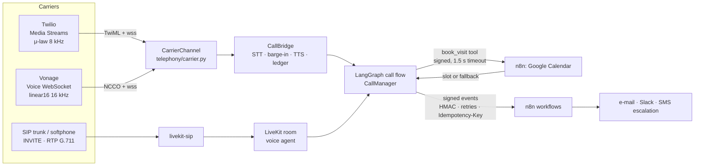

# FinCall: technical overview

Details behind the [README](../README.md): languages, browser calls, carriers and n8n, the NLP
layer and the call KPIs.

## Multilingual architecture

The agent speaks **Spanish (es-ES), US English (en-US), Catalan (ca-ES), Arabic (ar-AE), Hindi
(hi-IN) and Urdu (ur-PK)** on one shared LangGraph graph. A language is configuration, not code.

```text
 caller audio ─▶ STT (AssemblyAI EU, language_codes) ──text──▶ CallManager
                    ▲  UpdateConfiguration on switch               │ i18n.use(call language)
                    │                                              │ personas.use(client persona)
                    │                                              ▼
            detection ◀── first turns: script + function words ── graph (shared nodes)
            (+ AssemblyAI's language_code / confidence)            │  parser_for(lang): yes/no,
                                                                   │  apartments, set phrases
                                                                   │  render(id): template in lang
                                                                   │  LLM prompt set: es | en+note
                                                                   ▼
 caller ear ◀── TTS chain per language (ElevenLabs → Piper → MeloTTS) ◀── reply text
```

- **One file per language**: `backend/src/building_call/i18n/locales/<code>.toml` holds the
  locale, RTL flag, STT/TTS settings and voices, the word lists of the deterministic paths
  (yes/no, refusals, set phrases, spelled-out numbers, floors and apartment words, gas/fire),
  the translations of every template, FAQ answers, detail questions and admin-facing phrases.
  Adding a 7th language means adding one file: the tests check it translates every template
  with the same variables and question marks.
- **Rules no word list can express** live in `i18n/parsing.py` (`Parser`, generic and lexicon
  driven; `SpanishParser` keeps the rules tuned on real Spanish calls). Formats (dates, numbers,
  currency, ordinals, lists) come from CLDR via Babel (`i18n/formatting.py`).
- **Choosing the language of a call**: explicit (`POST /api/calls {"language"}`, the console,
  a `language` Media Streams parameter, `BC_TWILIO_NUMBER_LANGUAGES` per called number), else
  `BC_LANGUAGE` plus **detection** of the caller's first turns (`i18n/detection.py`: script,
  Arabic vs Urdu letters and words, distinctive function words for Latin script, AssemblyAI's
  reported language when it is sure). It switches only above `BC_LANGUAGE_DETECTION_THRESHOLD`
  (default 0.6), otherwise the call stays in the default language. Asking by name ("English,
  please") switches at any time and the current question is asked again in that language.
- **Mid-call switch**: STT is steered with AssemblyAI `UpdateConfiguration` (no reconnect), TTS
  changes `language_code`/voice per sentence; the phone bridge, the console WebSocket and the
  LiveKit agent all follow it.
- **Prompts**: Spanish keeps its measured prompt set; every other language uses the English
  prompts (what models follow best) plus a note asking for values in the caller's language.
- **Client personas** (`i18n/personas/<id>.toml`): agent name, ElevenLabs voice, tone for the
  phrasing model, greeting and FAQ answers per language; chosen per number
  (`BC_TWILIO_NUMBER_PERSONAS`), per call or by `BC_PERSONA`.
- **Console**: six UI languages, right-to-left for Arabic and Urdu (`frontend/src/i18n`).

### Providers per language

Checked against the providers' current documentation (November 2026).

| Language | STT (streaming) | Server TTS | Local TTS (dev) | Twilio `<Say>` fallback | LLM |
|---|---|---|---|---|---|
| es-ES | AssemblyAI Universal-Streaming (EU) | ElevenLabs `eleven_v4_turbo` | Piper `es_ES-davefx-medium`, MeloTTS | `Polly.Lucia-Neural` | Gemini (Vertex EU) / Ollama |
| en-US | AssemblyAI (EU) | ElevenLabs | Piper `en_US-lessac-medium`, MeloTTS | `Polly.Joanna-Neural` | Gemini / Ollama |
| ca-ES | AssemblyAI (EU) | ElevenLabs (v3/v4 only: Flash v2.5 has no Catalan) | Piper `ca_ES-upc_ona-medium` | `Polly.Arlet-Neural` | Gemini |
| ar-AE | AssemblyAI (EU) | ElevenLabs | Piper `ar_JO-kareem-medium` | `Polly.Hala-Neural` | Gemini |
| hi-IN | AssemblyAI (EU) | ElevenLabs | Piper `hi_IN-pratham-medium` | `Polly.Kajal-Neural` | Gemini |
| ur-PK | AssemblyAI (EU) | ElevenLabs (v3/v4 only) | **none** (no Piper voice) | **none**: falls back to `BC_LANGUAGE`'s voice | Gemini |

Fallbacks: the server TTS is a per-language chain (`FallbackSynthesizer`): the configured
provider first, then the next available one that speaks the language; Urdu has no local voice,
so without ElevenLabs it has no server voice (the console then uses the browser's voice, if the
OS has an Urdu one). If AssemblyAI is unavailable, the console falls back to the browser's
speech recognition (`browser_lang`); phone calls need AssemblyAI. Local Ollama models are weak
in Urdu and Hindi: use Gemini for those languages in production.

## Run the demo

One script starts everything for a browser call through Twilio: the API with in-memory data
(no PostgreSQL), the console behind ngrok, and Twilio browser calls.

1. Once: `backend/.secretbroker` maps `BC_TWILIO_ACCOUNT_SID`, `BC_TWILIO_AUTH_TOKEN`,
   `BC_TWILIO_API_KEY_SID` and `BC_TWILIO_API_KEY_SECRET` (names only, no values), and
   `BC_TWILIO_TWIML_APP_SID`, `BC_OWNER_EMAIL` and the voice settings are in `backend/.env`.
2. Give it your fixed ngrok domain, then run it:

   ```powershell
   $env:BC_PUBLIC_URL = "https://<your-domain>.ngrok-free.dev"   # or -PublicUrl, or a SecretBroker config entry
   .\scripts\start-demo.ps1
   ```

   It prints the URL to open once `/api/health` answers through the tunnel. Ctrl+C stops the
   API, the console and ngrok. Logs are in `%TEMP%\fincall-demo`.
3. Open the URL, click *Visit Site* on the ngrok notice, and sign in with Google or Microsoft.
4. In **Simulate a call**, pick the voice mode **Twilio**, choose the call language (or
   *Detect automatically*), and press **Start call**.

Data lives in memory and is gone when the script stops. A browser call costs Twilio's Client
rate per minute.

## Talking to the agent from the browser, as a phone caller

Two ways to test the **phone path** (μ-law 8 kHz, server STT and TTS, barge-in, delivery
ledger, two-track recording) without a phone number. Both are voice modes of the console's
simulator, and the console follows the call live in either.

**1. Phone line (no Twilio): `Phone line` mode.** The browser captures the microphone at 8 kHz,
encodes G.711 μ-law in 20 ms frames and sends them over `WS /api/telephony/browser/line`, which
speaks the Twilio Media Streams protocol (`start`/`media`/`mark`/`clear`/`stop`) and plugs into
the same `CallBridge` as a phone call (`telephony/browser_line.py`, `frontend/src/phoneLine.ts`).
It needs only the console session, `BC_ASSEMBLYAI_API_KEY` and a server voice (`BC_TTS`): no
Twilio account, no public URL, no cost beyond STT/TTS.

**2. Twilio Voice JS SDK (WebRTC): `Twilio` mode.** The browser gets a 15-minute Access Token
(`POST /api/telephony/twilio/browser-token`, identity `console_<user>`) and dials a TwiML App
whose voice URL is the same webhook as the phone number; Twilio then opens the Media Stream to
the bridge. The real carrier path, still with no phone number. Setup, once:

1. Twilio credentials in SecretBroker (tag `fincall`): account SID and auth token
   (`BC_TWILIO_ACCOUNT_SID`, `BC_TWILIO_AUTH_TOKEN`), `BC_TELEPHONY=twilio`.
2. A **Standard API key** created in the Twilio console (Account → API keys); store its SID and
   secret as `BC_TWILIO_API_KEY_SID` / `BC_TWILIO_API_KEY_SECRET` (Access Tokens are signed with it).
3. A public https URL for the API (`BC_PUBLIC_URL`, e.g. the fixed ngrok domain) so Twilio can
   reach the webhook and the Media Stream.
4. `uv run python -m building_call.telephony.configure --twiml-app` creates or updates the
   "FinCall console" TwiML App (voice URL = the webhook) and prints `BC_TWILIO_TWIML_APP_SID`.
   It creates nothing else and buys nothing; browser (Client) minutes are billed by Twilio at its
   Client rate when a call is made.
5. Restart the API: `GET /api/health` shows `twilio_browser: true` and the console enables the
   mode. On a trial account Twilio plays a short notice first; the console presses the key.

## Integrations

How calls reach the agent and how the agent reaches the rest of the business:



| Integration | What it does | Status | Code / docs |
|---|---|---|---|
| **Twilio** | Inbound calls over Media Streams: signed TwiML webhook, μ-law WebSocket, marks, `clear` barge-in, DTMF; also the browser call (Voice JS SDK) above | Tested with a fake carrier; no live number yet | `telephony/twilio.py`, `docs/TELEFONIA.md` |
| **Vonage** | Answer webhook → NCCO `connect` to a linear16 16 kHz WebSocket; signed JWT webhooks, `notify` marks, `clear`, `websocket:dtmf` | **Mocks only, never tested live** (no account) | `telephony/vonage.py`, «Twilio vs Vonage» in `docs/TELEFONIA.md` |
| **SIP** | `livekit-sip` answers INVITEs from a trunk or a local softphone, one LiveKit room per call, REFER to a person | Local pilot with a softphone and an automated SIP bench; no real trunk yet | `telephony/sip.py`, «SIP: decisión y diseño» in `docs/TELEFONIA.md` |
| **n8n** | Signed call events (`call.started`, `ticket.created`, `emergency.detected`, `handoff.requested`, `call.ended`) and the `book_visit` tool node the agent calls during the call | Unit-tested; run end to end against a local n8n (see below) | `integrations/`, `integrations/n8n/README.md` |

All carriers implement one interface (`CarrierChannel`: `audio_format`, `send_audio`, `mark`,
`clear`, `hang_up`), so the speech pipeline, the graph and the metrics are the same whoever
carries the call. Language follows the call everywhere: carriers pass it to the bridge (Twilio
stream parameter, Vonage Answer URL), and n8n events and tool requests carry `language`, so
workflows answer and notify in it. Integrations are best-effort: if n8n is down, the call goes on exactly as it
would without it.

Local n8n: `sb run -- docker compose --profile n8n up -d n8n`, import the workflows from
`integrations/n8n/`, then set `BC_N8N_WEBHOOK_URL` / `BC_N8N_TOOL_URL` (step by step in
`integrations/n8n/README.md`).


## NLP models and evaluation

The call graph interprets each caller turn with one LLM request. `backend/src/building_call/nlp/`
adds classic NLP in front of it, **off by default** (`BC_NLP_HYBRID=false`):

- **Turn classifier (Hugging Face, SetFit).** A multilingual sentence-transformer
  (`paraphrase-multilingual-MiniLM-L12-v2`), fine-tuned contrastively, with one
  logistic-regression head each for intent, incident category, urgency and work type. One encode
  answers all four in about 10 ms on CPU. Training data, the reproducible script and the reasons
  for this model are in [`backend/nlp/MODEL_CARD.md`](backend/nlp/MODEL_CARD.md). The weights
  are not in git; `nlp/train_classifier.py` rebuilds them in about a minute on an RTX 4070
  SUPER.
- **spaCy entities.** One blank pipeline per language with an `EntityRuler`: address, entrance,
  floor, door, building, name, phone and email in es, en, ca, ar, hi and ur. The home words come
  from each language's locale file.
- **Hybrid routing.** The classifier answers first. The graph skips the LLM only when every
  needed label is at or above `BC_NLP_THRESHOLD` (0.8) and no entity is found in the turn. That
  covers two cases: a global intent with no data ("¿esto se graba?", "quiero hablar con una
  persona") and a plain problem description. Corrections always go to the LLM. Handing over or
  hanging up still needs the caller's explicit words.

Results on the gold sets, which are never trained on (`evals/gold_*.jsonl`): es has 81 intent
rows and 46 classification rows; en has 131 intent rows and 46 classification rows. The LLM is
the local `qwen3.5:latest` (9.7B, Ollama).

| Language | System | Intent acc | Intent macro-F1 | Category acc | Category macro-F1 | Urgency acc | Urgency macro-F1 | p50 ms | p95 ms | Turns to the LLM | USD / 1,000 calls* |
|---|---|---|---|---|---|---|---|---|---|---|---|
| es | LLM only | 77.8 % | 0.690 | 97.8 % | 0.985 | 100 % | 1.000 | 5 289 | 6 615 | 100 % | 0.66 |
| es | Classifier only | 81.5 % | 0.748 | 84.8 % | 0.895 | 67.4 % | 0.627 | 9 | 11 | 0 % | 0.00 |
| es | **Hybrid @ 0.8** | **80.2 %** | **0.806** | 97.8 % | 0.985 | 100 % | 1.000 | 5 204 | 6 624 | 91 % | 0.60 |
| en | LLM only | 90.8 % | 0.872 | 97.8 % | 0.988 | 97.8 % | 0.984 | 2 042 | 3 553 | 100 % | 0.67 |
| en | Classifier only | 82.4 % | 0.660 | 87.0 % | 0.894 | 69.6 % | 0.701 | 10 | 13 | 0 % | 0.00 |
| en | **Hybrid @ 0.8** | **91.6 %** | **0.901** | 97.8 % | 0.988 | 97.8 % | 0.984 | 2 029 | 3 564 | 94 % | 0.63 |

\* LLM requests priced as the production model (`gemini-3.5-flash-lite`: $0.30 / $2.50 per
1M input/output tokens, Gemini API price list, 2026-11-24). Tokens are estimated (characters /
4), and a call is assumed to make 4 LLM-eligible turns. Local models cost $0.

```powershell
cd backend
uv sync --extra nlp
uv run python nlp/data/build_dataset.py --seed 13
uv run python nlp/train_classifier.py
uv run python evals/compare_nlp.py --llm qwen3.5:latest --language es --thresholds 0.6,0.7,0.8,0.9,0.95
uv run python evals/compare_nlp.py --llm qwen3.5:latest --language en --thresholds 0.6,0.7,0.8,0.9,0.95
uv run python evals/compare_nlp.py --entities-only --language es   # spaCy vs regex
```

What the numbers say:

- **Hybrid beats LLM-only on intent in both languages and never loses on category or urgency.**
  The classifier catches questions to the assistant that the LLM misses ("question" F1 goes
  from 0.00 to 0.80 in Spanish and from 0.80 to 1.00 in English). It answers 6 to 9 % of turns
  without the LLM, which cuts the estimated cost by 6 to 9 %.
- **The classifier alone is not enough.** Urgency is a judgement call and the classifier gets
  67 to 70 % of it. Since the router needs category, urgency and work type all at or above the
  threshold, problem descriptions stay on the LLM. At 0.7 the router starts answering them, and
  English category accuracy drops to 95.7 %. 0.8 is the lowest threshold with no loss in either
  language. The threshold sweep (0.6 to 0.95) is in `evals/last_nlp_result*.json`.
- **Latency:** the classifier adds about 10 ms per turn. The LLM latencies above come from a
  9.7B model that did not always fit fully in GPU memory on the test machine (other apps were
  holding VRAM; the es run was the slower one). They show the relative cost, not production
  latency. The production LLM (Vertex
  `gemini-3.5-flash-lite`) was measured at p50 626 / p95 722 ms (`settings.py`). The saving
  is the classifier-answered turns, which take about 11 ms instead of an LLM round trip.
- **Entities (gold recall).** In Spanish, the combined extractor lifts door from 38 % (regex) to
  88 % and floor from 92 % to 100 %. It adds address (83 %) and name (100 %), which the regex
  never had. In English, address and name reach 100 %, and floor and door stay as good as the
  regex. Arabic, Hindi, Urdu and Catalan have unit tests but no gold set yet.

Cloud LLMs: `BC_LLM=openai` (Responses API with strict Structured Outputs, default
`gpt-6-luna`) and `BC_LLM=bedrock` (Converse API with structured output, Bedrock API key,
`eu-*` regions only, default `eu.anthropic.claude-haiku-5-5`) sit behind the same interface. Compare
them with `sb run -- uv run python evals/compare_models.py --models openai:gpt-6-luna,bedrock:eu.anthropic.claude-haiku-5-5`
once their keys are in SecretBroker (`BC_OPENAI_API_KEY`, `BC_BEDROCK_API_KEY`).

## Call metrics

`GET /api/operations/kpis?limit=200` (aggregate of the last N stored calls) and
`GET /api/operations/calls/{id}/kpis` (one call) compute conversation KPIs from what the
operational repository already stores: calls, turns and graph decisions. They have the
reviewer roles of the rest of the console and return no personal data. The **Rendimiento**
screen shows them in a panel (texts in the six console languages, RTL for Arabic and Urdu; see
`docs/screenshots/kpi-panel-*.png`).

| KPI | Definition (`backend/src/building_call/kpis.py`) |
|---|---|
| Containment rate | Finished calls the assistant resolved alone (result `incident_created`) |
| Human handoff rate | Finished calls where the caller asked for a person (`handed_to_administrator`) |
| Needs the administrator | Finished calls that were not contained, abandoned ones excluded |
| Abandon rate | Finished calls that ended `abandoned` |
| Reprompt / fallback rate | Caller turns where the conversation did not move on (same node after the turn, or a repeat/filler), over all caller turns |
| Emergency rate | Calls that reached `handle_emergency` without ruling the emergency out |
| Turns per call, LLM requests per call | Caller turns (the greeting does not count); `llm_calls` from the turn timings |
| Average handle time | `finished_at - started_at` of finished calls |
| Latency p50 / p95 | `response_ms` (end of caller voice to start of bot voice, from the metrics registry) and `server_ms` (stored per turn) |
